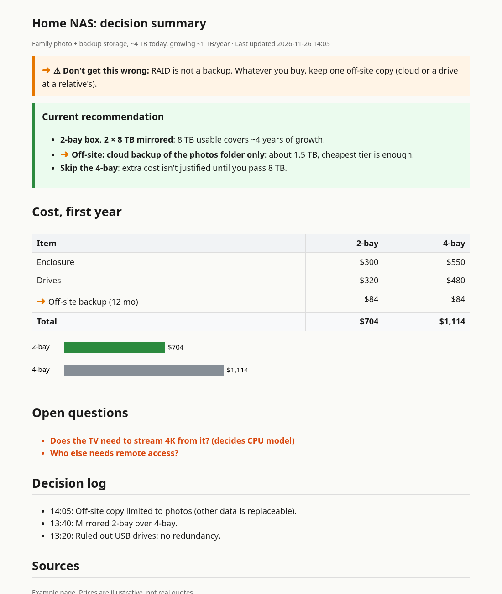

# webme: AI conversation assistant

**Live web pages that summarize your AI coding conversation, kept up to date while you talk.**

Long chats with an AI agent scroll away. The recommendation from an hour ago,
the numbers you compared, the question still waiting for an answer: all buried
somewhere in the transcript. **webme** gives you a page in your browser that
shows **where the conversation stands right now**, and the agent rewrites it
every turn. Orange arrows show what just changed.



*An example summary page ([source](examples/webme-home-nas-summary.html)). It's a plain HTML file that refreshes itself every 15 seconds.*

---

## What it does

- **A running summary of the conversation.** Current recommendation (with the
  *why*), the key numbers, steps, open questions, a dated decision log, sources.
  It shows what's true *now*: stale content is replaced, not appended.
- **➜ Change markers.** Every turn, the agent clears the old arrows and marks
  exactly what it just changed, so you see the update at a glance.
- **More than one page.** Ask for a chart, a document list or a report and you
  get a separate page next to the summary. The agent decides on its own whether
  a request adds to an existing page or needs a new one, and tells you which.
- **Pages stay in sync.** When a number changes on the summary, the chart that
  shows it is redrawn in the same turn.
- **The right visual for the job.** Tables for comparisons, inline SVG bar
  charts for magnitudes, flow diagrams for sequences and deadlines.
- **Private and offline.** Each page is a single self-contained HTML file on
  your machine. There are no CDNs, no external scripts and no uploads.

## Install

### Claude Code (full experience)

```
/plugin marketplace add TerminatedProcess/webme-ai-conversation-assistant
/plugin install webme@webme-ai-conversation-assistant
```

Or from your shell:

```bash
claude plugin marketplace add TerminatedProcess/webme-ai-conversation-assistant
claude plugin install webme@webme-ai-conversation-assistant
```

This installs the skill **and** a small session-start hook that:
- reopens your pages and reminds the agent about them when you resume a conversation or it gets compacted, and
- deletes pages that haven't changed for 14 days.

### Other coding agents (Codex, Cursor, Gemini CLI, …)

The skill is a standard [Agent Skill](https://agentskills.io): a folder with a
`SKILL.md` file. Copy [`skills/webme/`](skills/webme) into your agent's skills
directory. The pages work the same. Without the hook you don't get auto-reopen
on resume or the 14-day cleanup. You can wire
[`hooks/webme-session-start.sh`](hooks/webme-session-start.sh) into your
agent's own session-start hook if it has one, or delete old pages from
`~/webme/` yourself.

## Use it

Just ask. In Claude Code you can also run the command directly: `/webme:webme`
(or `/webme`, if no other command has that name).

| You say | You get |
|---|---|
| `webme` | A living summary of the conversation so far, updated every turn |
| `webme: pie chart of the budget allocation` | A separate chart page. It's redrawn when the numbers change. |
| `webme: list the tax documents for 2022–2024` | A separate document-list page |
| *(later, same chat)* `add 2021 to the tax list` | The existing list page is updated, with arrows on the new rows |

**The first time** the skill runs on a machine, it asks whether to use your
**default browser or a specific one**, and remembers the answer.

## How it works

### Where pages live

All pages go to **`~/webme/`** (Windows: `%USERPROFILE%\webme`), named
`webme-<topic>-<purpose>.html`. That's outside your repos, so pages never get
committed by accident. Your browser choice is saved in `~/webme/.browser`.

### Living pages and snapshot pages

| Kind | Example | Updated |
|---|---|---|
| **living** | the conversation summary | every turn that adds a fact, number, decision or question |
| **snapshot** | a chart, a document list, a report | when you ask, or when the data it shows changes |

Each page records its kind and a one-line purpose in `<meta>` tags. That's how
the agent matches later requests to the right page.

### Lifetime

- A page stays active for the **whole conversation**.
- **`/clear` or a new conversation ends the topic.** Old pages are never edited
  again. If you want one back, the agent builds a new page from it.
- Pages expire **14 days** after their last change (the hook deletes them).

### What a summary page contains

The agent uses the sections that fit the topic, roughly in this order:

| Section | Purpose |
|---|---|
| Header | One line of context and "Last updated" |
| Alert box (orange) | Deadlines, risks, the one thing not to get wrong |
| Current recommendation (green) | The answer as of now, with the *why* |
| Numbers | Comparison tables, totals, scenarios |
| Steps / flow | Ordered actions or a diagram |
| Things to know | Concepts that needed explaining |
| Open questions | Unknowns, most important first |
| Decision log | Dated, append-only |
| Sources | Links and the date each was checked |

## Requirements and platforms

| | Supported |
|---|---|
| **Claude Code**, Linux / macOS | ✔ Full: skill and hook. The hook needs `bash` and `jq`. |
| **Claude Code**, Windows | ✔ With [Git for Windows](https://gitforwindows.org) (Claude Code runs hooks in Git Bash) and `jq` |
| **Other coding agents** that read `SKILL.md` | ✔ Skill only (see above) |
| **Cloud sessions** (e.g. Claude Code on the web) | ✖ The page would be written on the remote machine, where your browser can't open it. The skill says so and keeps the summary in chat. |
| **Chat-only apps** (no local file access) | ✖ |

If `jq` is missing, the hook silently does nothing. The skill still works.

**Optional:** with the [Claude in Chrome](https://claude.com/chrome) extension,
Claude can screenshot and check its own pages after big layout changes.

## Privacy

Pages often hold personal details: finances, health, legal matters. The skill
tells the agent to **keep them local**: never upload, publish or share them.
Each page is a self-contained file with no network requests.

## Repository layout

```
.claude-plugin/
  plugin.json            # Claude Code plugin manifest
  marketplace.json       # lets this repo act as its own plugin marketplace
skills/webme/SKILL.md    # the skill: the instructions the agent follows
hooks/
  hooks.json             # registers the session-start hook (Claude Code)
  webme-session-start.sh # cleanup on startup/clear; reopen + remind on resume/compact
examples/                # a sample page
docs/screenshot.png
```

## Contributing

Issues and pull requests are welcome. If you change page behavior, describe it
in `skills/webme/SKILL.md`: that file *is* the product.

## License

[MIT](LICENSE)
